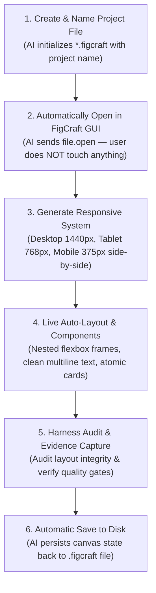

# 🎨 FigCraft Live MCP Server (`figcraft-mcp`)

[](https://opensource.org/licenses/MIT)
[](https://modelcontextprotocol.io)
[](https://nodejs.org)
[](https://www.typescriptlang.org)

Official, production-grade **Model Context Protocol (MCP)** server for **FigCraft** (ArtCraft Team). Enables AI coding assistants (Antigravity IDE, Claude Desktop, Cursor, VS Code) to create design files, **automatically open them immediately in the GUI**, and generate UI/UX live on the user's screen in real-time with **Figma-grade Auto-Layout**, **Responsive Multi-Viewport Artboard Systems**, and **Harness MCP Quality Gates**.

---

## ⚡ The Canonical 1-by-1 Automated Workflow

In traditional workflows, AI agents generated design files in the background, leaving users to manually browse files and open them in FigCraft. 

`figcraft-mcp` enforces the strict **1-per-1 Automated Pipeline**:



1. **Step 1 — Create Project File**: Generates canonical `.figcraft` document (ZIP archive containing `document.json`) with the specified project name.
2. **Step 2 — Automatically Open File in GUI**: Directly issues `file.open` to the running FigCraft GUI window on port 9099. The tab opens instantly on the user's desktop monitor without any manual intervention.
3. **Step 3 — Responsive Artboard System**: Generates synchronized responsive viewports (`Desktop 1440px`, `Tablet 768px`, `Mobile 375px`) side-by-side on the canvas.
4. **Step 4 — Figma-Grade Auto-Layout**: Builds structured components (`navbar`, `hero`, `card`) using nested Auto-Layout containers with explicit padding, gap, and alignment so layouts never float or break. Automatically cleans unescaped `\n` literals so headlines render with real line-breaks.
5. **Step 5 — Harness MCP Collaboration**: Audits layout hygiene (`figcraft_audit_layout`), scores design quality (0-100), and records visual snapshots into Harness quality checkpoints (`responsive-design-and-layout-integrity`).

---

## 🚀 Quickstart

### 1. Prerequisites
* **FigCraft Desktop App** installed (`figcraft.exe`).
* **Node.js** >= 18.0.0.

### 2. Run with NPX
```bash
npx figcraft-mcp
```

### 3. Or Clone & Build Locally
```bash
git clone https://github.com/vickymosafan/figcraft-mcp.git
cd figcraft-mcp
npm install
npm run build
npm start
```

---

## ⚙️ MCP Client Configuration

Add `figcraft-mcp` to your favorite AI agent / editor:

### 🌟 Antigravity IDE (`~/.gemini/antigravity/mcp_config.json`)
```json
{
  "mcpServers": {
    "figcraft": {
      "command": "node",
      "args": ["d:/portfolio-project-2026/mcp_figcraft/dist/index.js"]
    }
  }
}
```

### 🟣 Claude Desktop (`claude_desktop_config.json`)
```json
{
  "mcpServers": {
    "figcraft": {
      "command": "npx",
      "args": ["-y", "figcraft-mcp"]
    }
  }
}
```

### ⚡ Cursor (`.cursor/mcp.json`)
```json
{
  "mcpServers": {
    "figcraft": {
      "command": "npx",
      "args": ["-y", "figcraft-mcp"]
    }
  }
}
```

---

## 🛠️ MCP Tools Reference (13 Tools)

| Tool Name | Parameters | Description |
|---|---|---|
| `figcraft_create_and_open` | `filePath` (string), `projectName` (string) | **Langkah 1 & 2**: Buat file kanonik `.figcraft` beserta nama proyek, lalu otomatis langsung buka di jendela aktif FigCraft GUI. |
| `figcraft_create_responsive_system` | `projectName` (string), `theme` ('dark'\|'light') | **Responsive System**: Buat 3 Artboard sinkron berdampingan (Desktop 1440px, Tablet 768px, Mobile 375px) dengan Auto-Layout vertikal. |
| `figcraft_create_autolayout_frame` | `name`, `direction`, `gap`, `padding`, `mainAlign`, `crossAlign`, `sizingH`, `sizingV`, `bgColor` | **Figma Flexbox**: Buat kontainer Auto-Layout terstruktur sehingga anak-anak elemen tidak floating atau berantakan. |
| `figcraft_create_component` | `type` ('navbar'\|'hero'\|'card'), `parent` (number), `options` (object) | **Atomic Components**: Render komponen tingkat tinggi siap pakai tanpa layer berantakan. |
| `figcraft_audit_layout` | *(none)* | **Harness Audit**: Audit otomatis kualitas kanvas (layer spaghetti, teks literal `\n`, cakupan responsif) dan hasilkan bukti Harness quality gate. |
| `figcraft_create_node` | `type`, `name`, `parent`, `x`, `y`, `width`, `height`, `text`, `props` | **Langkah 3**: Gambar elemen visual secara live di kanvas dengan pembersihan otomatis karakter `\n`. |
| `figcraft_set_properties` | `id` (number), `props` (object) | Ubah styling, warna (`fills`), garis (`strokes`), tipografi, dan auto-layout pada layer aktif. |
| `figcraft_batch` | `commands` (array) | Jalankan serangkaian perintah desain FigCraft secara atomik dalam satu batch transaksi. |
| `figcraft_inspect_document` | `depth` (number), `allPages` (boolean) | Ambil tree hierarki lengkap dari seluruh layer, halaman, dan styling dokumen aktif sebagai JSON. |
| `figcraft_open_file` | `filePath` (string) | Buka berkas desain (.figcraft, .json, .fig, .sketch, .svg, gambar) ke tab aktif jendela FigCraft. |
| `figcraft_save_file` | `path` (string, opsional) | Simpan dokumen kanvas aktif ke disk (.figcraft). |
| `figcraft_screenshot` | `ids` (array), `scale` (number) | Rekam snapshot visual kanvas aktif atau frame tertentu dalam format PNG resolusi tinggi. |
| `figcraft_ensure_gui` | *(none)* | Periksa dan luncurkan otomatis jendela FigCraft GUI pada port kontrol 9099 jika belum aktif. |

---

## 🤝 Kolaborasi Powerful: Harness MCP + FigCraft MCP

FigCraft MCP dirancang untuk berkolaborasi langsung dengan **`principal-agentic-harness`**:

1. **Claim Task di Harness**:
   Agen mengklaim tugas desain UI/UX melalui `harness.claim_task`.
2. **Inisialisasi Kanvas & Sistem Responsif**:
   Agen membuat berkas dengan `figcraft_create_and_open`, lalu menghasilkan 3 artboard responsif (`Desktop 1440`, `Tablet 768`, `Mobile 375`) via `figcraft_create_responsive_system`.
3. **Desain Komponen Bebas Berantakan**:
   Agen menggunakan `figcraft_create_component` dan `figcraft_create_autolayout_frame`. Semua teks otomatis dibersihkan dari escaped `\n` dan seluruh anak elemen tersusun rapi dalam flexbox layout.
4. **Audit Otomatis & Rekam Bukti**:
   Agen menjalankan `figcraft_audit_layout`. Laporan audit yang berisi skor kualitas (0-100) dan metrik Auto-Layout langsung direkam ke Harness melalui `harness.record_evidence`.
5. **Verifikasi Quality Gate**:
   Checkpoint `responsive-design-and-layout-integrity` ditandai lulus via `harness.update_quality_checkpoint`.

---

## 🔬 Reverse-Engineering & Architecture Deep-Dive

Proyek ini dibangun dan diaudit menggunakan **MCP REA (Reverse Engineer Anything)** dan **Context7 MCP**:

1. **IPC Wire Protocol Tracing**:
   * Melalui socket interception dan inspeksi binary REA, FigCraft GUI berkomunikasi pada `127.0.0.1:9099` menggunakan newline-delimited JSON.
   * Format eksekusi:
     ```json
     {"id": 1, "method": "engine.execute", "params": {"agent": "ai", "command": "node.create", "params": {"type": "frame", ...}}}
     ```
2. **Normalisasi Auto-Layout**:
   * Engine FigCraft membutuhkan parameter alignment huruf kecil: `mainAlign: 'min' | 'center' | 'max' | 'spaceBetween'` dan `crossAlign: 'min' | 'center' | 'max' | 'baseline'`. FigCraft MCP secara otomatis menormalkan input dari format web/Figma (`start`, `end`, `space-between`).
3. **Pembersihan Escaped String**:
   * Menghilangkan bug literal `\n` yang sebelumnya muncul pada headline kanvas menjadi line-break nyata.

---

## 📁 Repository Structure

```
figcraft-mcp/
├── bin/
│   └── figcraft-mcp.js       # CLI runner for npx execution
├── src/
│   ├── index.ts              # Main stdio MCP entrypoint
│   ├── server.ts             # McpServer instance & tool definitions
│   ├── client.ts             # FigCraft Wire Socket Client (Port 9099)
│   ├── layout.ts             # Auto-Layout normalizer, tokens & text sanitizer
│   ├── components.ts         # High-level atomic UI components (Navbar, Hero, Card)
│   ├── audit.ts              # Harness-ready layout quality audit & evidence generator
│   ├── template.ts           # Canonical .figcraft project builder
│   └── types.ts              # TypeScript interfaces & types
├── dist/                     # Compiled production ESM & types
├── package.json              # NPM manifest & metadata
├── tsconfig.json             # TypeScript configuration
├── LICENSE                   # MIT License
└── README.md                 # Complete documentation
```

---

## 📄 License

Distributed under the MIT License. See [LICENSE](LICENSE) for more information.

**Author:** [Vicky Mosafan](https://github.com/vickymosafan)
