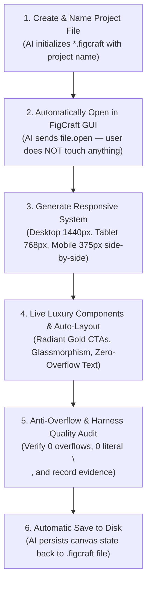

# 🎨 FigCraft Live MCP Server (`figcraft-mcp`)

[](https://opensource.org/licenses/MIT)
[](https://modelcontextprotocol.io)
[](https://nodejs.org)
[](https://www.typescriptlang.org)

Official, production-grade **Model Context Protocol (MCP)** server for **FigCraft** (ArtCraft Team). Enables AI coding assistants (Antigravity IDE, Claude Desktop, Cursor, VS Code) to create design files, **automatically open them immediately in the GUI**, and generate UI/UX live on the user's screen in real-time with **Figma-grade Auto-Layout**, **Luxury Obsidian Titanium Theming**, **Anti-Overflow Text Constraints**, and **Harness MCP Quality Gates**.

---

## ⚡ The Canonical 1-by-1 Automated Workflow

In traditional workflows, AI agents generated design files in the background, leaving users to manually browse files and open them in FigCraft. 

`figcraft-mcp` enforces the strict **1-per-1 Automated Pipeline**:



---

## 💎 Solusi Visual & Perbaikan Layout (v1.3.0)

Berdasarkan riset dokumentasi **Context7 MCP** untuk Figma Plugin API dan Tailwind CSS v4 design tokens:

1. **Anti-Overflow Text Wrapping (`textAutoResize: 'height'`)**:
   * Menghilangkan teks yang meluber keluar dari kartu dengan memaksa text node menggunakan `textAutoResize: 'height'` dan pembatasan lebar (`sizingH: 'fill'` / constrained width), sehingga teks secara otomatis membungkus (*wrap*) ke bawah secara rapi.
2. **Pembersihan Mutlak Karakter `\n`**:
   * Memastikan string multiline terkonversi menjadi karakter line-break asli, bukan string karakter `\n` literal.
3. **Palet Warna Luxury Obsidian Titanium**:
   * Menggantikan warna khaki/kusam dengan **Radiant Amber Gold** (`#F59E0B`), **Obsidian Space Canvas** (`#090D14`), **Glassmorphic Cards** (`#131B2CD9`), dan **Neon Emerald Badges** (`#064E3B66` + `#34D399`).
4. **Depth & Glassmorphism (`effects`)**:
   * Menambahkan drop shadow mewah (`effects: [{ type: 'dropShadow', color: '#F59E0B4D', radius: 24 }]`) pada tombol utama dan soft elevation shadow pada kartu.

---

## 🛠️ MCP Tools Reference (15 Tools)

| Tool Name | Parameters | Description |
|---|---|---|
| `figcraft_create_and_open` | `filePath` (string), `projectName` (string) | **Langkah 1 & 2**: Buat file kanonik `.figcraft` beserta nama proyek, lalu otomatis langsung buka di jendela aktif FigCraft GUI. |
| `figcraft_create_responsive_system` | `projectName` (string), `theme` ('luxury'\|'dark'\|'light') | **Responsive System**: Buat 3 Artboard sinkron berdampingan (Desktop 1440px, Tablet 768px, Mobile 375px) dengan Auto-Layout vertikal. |
| `figcraft_create_autolayout_frame` | `name`, `direction`, `gap`, `padding`, `mainAlign`, `crossAlign`, `sizingH`, `sizingV`, `bgColor`, `effects` | **Figma Flexbox**: Buat kontainer Auto-Layout terstruktur dengan drop shadow dan corner smoothing. |
| `figcraft_create_component` | `type` ('navbar'\|'hero'\|'card'), `parent` (number), `options` (object) | **Atomic Components**: Render komponen tingkat tinggi siap pakai dengan garansi anti-overflow. |
| `figcraft_fix_overflow` | *(none)* | **Anti-Overflow Auto-Fixer**: Pindai seluruh kanvas dan perbaiki otomatis teks yang melebihi batas kotaknya serta bersihkan literal `\n`. |
| `figcraft_apply_luxury_theme` | *(none)* | **Luxury Theming**: Terapkan palet Obsidian Titanium, tombol emas bersinar (glow), dan kartu kaca modern di seluruh kanvas. |
| `figcraft_audit_layout` | *(none)* | **Harness Audit**: Audit kualitas kanvas (overflow, teks literal `\n`, cakupan responsif) dan hasilkan bukti Harness quality gate. |
| `figcraft_create_node` | `type`, `name`, `parent`, `x`, `y`, `width`, `height`, `text`, `props` | **Langkah 3**: Gambar elemen visual secara live di kanvas dengan sanitasi teks otomatis dan auto-wrap. |
| `figcraft_set_properties` | `id` (number), `props` (object) | Ubah styling, warna (`fills`), garis (`strokes`), tipografi, dan auto-layout pada layer aktif. |
| `figcraft_batch` | `commands` (array) | Jalankan serangkaian perintah desain FigCraft secara atomik dalam satu batch transaksi. |
| `figcraft_inspect_document` | `depth` (number), `allPages` (boolean) | Ambil tree hierarki lengkap dari seluruh layer, halaman, dan styling dokumen aktif sebagai JSON. |
| `figcraft_open_file` | `filePath` (string) | Buka berkas desain (.figcraft, .json, .fig, .sketch, .svg, gambar) ke tab aktif jendela FigCraft. |
| `figcraft_save_file` | `path` (string, opsional) | Simpan dokumen kanvas aktif ke disk (.figcraft). |
| `figcraft_screenshot` | `ids` (array), `scale` (number) | Rekam snapshot visual kanvas aktif atau frame tertentu dalam format PNG resolusi tinggi. |
| `figcraft_ensure_gui` | *(none)* | Periksa dan luncurkan otomatis jendela FigCraft GUI pada port kontrol 9099 jika belum aktif. |

---

## 🤝 Kolaborasi Powerful: Harness MCP + FigCraft MCP

FigCraft MCP dirancang untuk berkolaborasi langsung dengan **`principal-agentic-harness`**:

1. **Claim Task di Harness**: Agen mengklaim tugas UI/UX melalui `harness.claim_task`.
2. **Inisialisasi Kanvas & Sistem Responsif**: Agen membuat berkas dengan `figcraft_create_and_open`, lalu menghasilkan 3 artboard responsif (`Desktop 1440`, `Tablet 768`, `Mobile 375`) via `figcraft_create_responsive_system`.
3. **Desain Komponen Bebas Overflow**: Agen menggunakan `figcraft_create_component` dan `figcraft_create_autolayout_frame`. Semua teks otomatis dibatasi dengan `textAutoResize: 'height'` sehingga tidak pernah meluber.
4. **Perbaikan Otomatis & Audit**: Agen menjalankan `figcraft_fix_overflow` dan `figcraft_audit_layout` untuk memastikan 0 overflow dan 0 literal `\n`.
5. **Rekam Bukti & Verifikasi Quality Gate**: Bukti audit kanvas langsung direkam ke Harness melalui `harness.record_evidence` dan checkpoint ditandai lulus via `harness.update_quality_checkpoint`.

---

## 📁 Repository Structure

```
figcraft-mcp/
├── bin/
│   └── figcraft-mcp.js       # CLI runner for npx execution
├── src/
│   ├── index.ts              # Main stdio MCP entrypoint
│   ├── server.ts             # McpServer instance & tool definitions (15 tools)
│   ├── client.ts             # FigCraft Wire Socket Client (Port 9099)
│   ├── layout.ts             # Luxury tokens, Auto-Layout normalizer & text sanitizer
│   ├── components.ts         # High-level atomic UI components (Navbar, Hero, Card)
│   ├── audit.ts              # Harness-ready layout audit & anti-overflow repair engine
│   ├── template.ts           # Canonical .figcraft project builder
│   └── types.ts              # TypeScript interfaces & types
├── dist/                     # Compiled production ESM & types
├── package.json              # NPM manifest & metadata
├── tsconfig.json             # TypeScript configuration
├── LICENSE                   # MIT License
└── README.md                 # Complete documentation
```

---

## 📄 License

Distributed under the MIT License. See [LICENSE](LICENSE) for more information.

**Author:** [Vicky Mosafan](https://github.com/vickymosafan)
