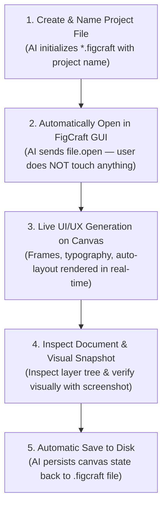

# 🎨 FigCraft Live MCP Server (`figcraft-mcp`)

[](https://opensource.org/licenses/MIT)
[](https://modelcontextprotocol.io)
[](https://nodejs.org)
[](https://www.typescriptlang.org)

Official, production-grade **Model Context Protocol (MCP)** server for **FigCraft** (ArtCraft Team). Enables AI coding assistants (Antigravity IDE, Claude Desktop, Cursor, VS Code) to create design files, **automatically open them immediately in the GUI**, and generate UI/UX live on the user's screen in real-time.

---

## ⚡ The Canonical 1-by-1 Automated Workflow

In traditional workflows, AI agents generated design files in the background, leaving users to manually browse files and open them in FigCraft. 

`figcraft-mcp` enforces the strict **1-per-1 Automated Pipeline**:



1. **Step 1 — Create Project File**: Generates canonical `.figcraft` document (ZIP archive containing `document.json`) with the specified project name.
2. **Step 2 — Automatically Open File in GUI**: Directly issues `file.open` to the running FigCraft GUI window on port 9099. The tab opens instantly on the user's desktop monitor without any manual intervention.
3. **Step 3 — Transparent Live UI/UX Generation**: Draws visual components (`node.create`, `batch`, `set_properties`) directly onto the active canvas. The user watches buttons, hero cards, and typography appear live on screen.

---

## 🚀 Quickstart

### 1. Prerequisites
* **FigCraft Desktop App** installed (`figcraft.exe`).
* **Node.js** >= 18.0.0.

### 2. Run with NPX
```bash
npx figcraft-mcp
```

### 3. Or Clone & Build Locally
```bash
git clone https://github.com/vickymosafan/figcraft-mcp.git
cd figcraft-mcp
npm install
npm run build
npm start
```

---

## ⚙️ MCP Client Configuration

Add `figcraft-mcp` to your favorite AI agent / editor:

### 🌟 Antigravity IDE (`~/.gemini/antigravity/mcp_config.json`)
```json
{
  "mcpServers": {
    "figcraft": {
      "command": "node",
      "args": ["d:/portfolio-project-2026/mcp_figcraft/dist/index.js"]
    }
  }
}
```

### 🟣 Claude Desktop (`claude_desktop_config.json`)
```json
{
  "mcpServers": {
    "figcraft": {
      "command": "npx",
      "args": ["-y", "figcraft-mcp"]
    }
  }
}
```

### ⚡ Cursor (`.cursor/mcp.json`)
```json
{
  "mcpServers": {
    "figcraft": {
      "command": "npx",
      "args": ["-y", "figcraft-mcp"]
    }
  }
}
```

---

## 🛠️ MCP Tools Reference (9 Tools)

| Tool Name | Parameters | Description |
|---|---|---|
| `figcraft_create_and_open` | `filePath` (string), `projectName` (string) | **Langkah 1 & 2**: Buat file kanonik `.figcraft` beserta nama proyek, lalu otomatis langsung buka di jendela FigCraft GUI. |
| `figcraft_open_file` | `filePath` (string) | Buka berkas desain (.figcraft, .json, .fig, .sketch, .svg, gambar) ke tab aktif jendela FigCraft. |
| `figcraft_create_node` | `type`, `name`, `parent`, `x`, `y`, `width`, `height`, `text`, `props` | **Langkah 3**: Gambar elemen visual secara live langsung di kanvas yang sedang terbuka (frame, teks, kartu, tombol). |
| `figcraft_set_properties` | `id` (number), `props` (object) | Ubah styling, warna (`fills`), garis (`strokes`), tipografi, dan auto-layout pada layer aktif. |
| `figcraft_batch` | `commands` (array) | Jalankan serangkaian perintah desain FigCraft secara atomik dalam satu batch transaksi. |
| `figcraft_inspect_document` | `depth` (number), `allPages` (boolean) | Ambil tree hierarki lengkap dari seluruh layer, halaman, dan styling dokumen aktif sebagai JSON. |
| `figcraft_save_file` | `path` (string, opsional) | Simpan dokumen kanvas aktif ke disk (.figcraft). |
| `figcraft_screenshot` | `ids` (array), `scale` (number) | Rekam snapshot visual kanvas aktif atau frame tertentu dalam format PNG resolusi tinggi. |
| `figcraft_ensure_gui` | *(none)* | Periksa dan luncurkan otomatis jendela FigCraft GUI pada port kontrol 9099 jika belum aktif. |

---

## 🔬 Reverse-Engineering & Architecture Deep-Dive

This project was built and audited using **MCP REA (Reverse Engineer Anything)** and **Context7 MCP**:

1. **IPC Wire Protocol Tracing**:
   * Through socket interception and REA binary inspection, FigCraft GUI was determined to listen on `127.0.0.1:9099` using newline-delimited JSON.
   * Execution format:
     ```json
     {"id": 1, "method": "engine.execute", "params": {"agent": "ai", "command": "file.open", "params": {"path": "..."}}}
     ```
   * Inspection format:
     ```json
     {"id": 2, "method": "document.inspect", "params": {"allPages": false, "depth": 4}}
     ```

2. **Windows NTFS Compatibility Bugfix**:
   * During REA diagnostics on Windows, an `ESTALE` issue was identified in `rea-agents@6.5.0` (`RegularFile.js` and `ArtifactReader.js`) where `fstat.dev !== lstat.dev` because Windows libuv returns the drive volume serial number for `fstat` and `0` for `lstat`.
   * A patch was applied to normalize device comparisons on `win32`, ensuring 100% stable execution across all REA inspection tools.

3. **Deterministic Canonical Templates**:
   * Standard `.figcraft` archives are ZIP containers holding a strict `document.json` schema. `figcraft-mcp` generates valid, crash-resistant project structures out-of-the-box.

---

## 📁 Repository Structure

```
figcraft-mcp/
├── bin/
│   └── figcraft-mcp.js       # CLI runner for npx execution
├── src/
│   ├── index.ts              # Main stdio MCP entrypoint
│   ├── server.ts             # McpServer instance & tool definitions
│   ├── client.ts             # FigCraft Wire Socket Client (Port 9099)
│   ├── template.ts           # Canonical .figcraft project builder
│   └── types.ts              # TypeScript interfaces & types
├── dist/                     # Compiled production ESM & types
├── package.json              # NPM manifest & metadata
├── tsconfig.json             # TypeScript configuration
├── LICENSE                   # MIT License
└── README.md                 # Complete documentation
```

---

## 🤝 Contributing

Contributions, issues, and feature requests are welcome!
Feel free to check [issues page](https://github.com/vickymosafan/figcraft-mcp/issues).

1. Fork the Project
2. Create your Feature Branch (`git checkout -b feature/AmazingFeature`)
3. Commit your Changes (`git commit -m 'Add some AmazingFeature'`)
4. Push to the Branch (`git push origin feature/AmazingFeature`)
5. Open a Pull Request

---

## 📄 License

Distributed under the MIT License. See [LICENSE](LICENSE) for more information.

**Author:** [Vicky Mosafan](https://github.com/vickymosafan)
